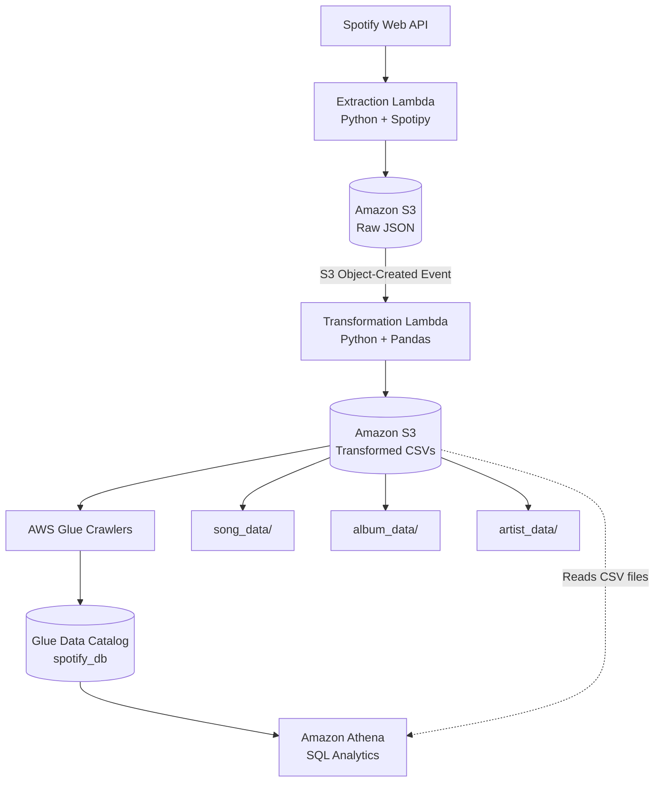
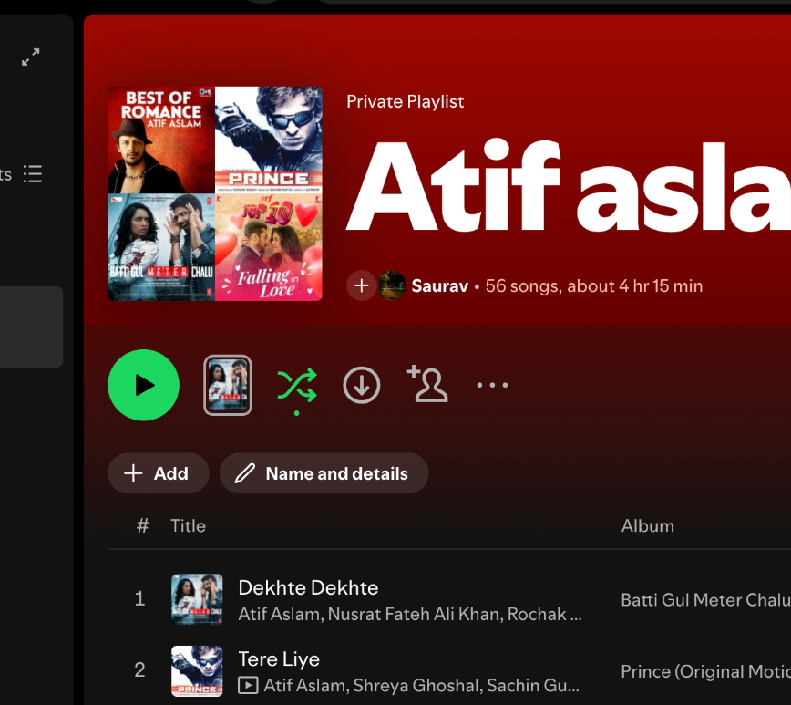
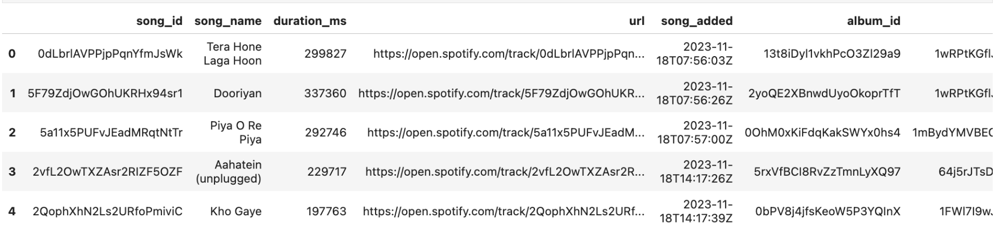
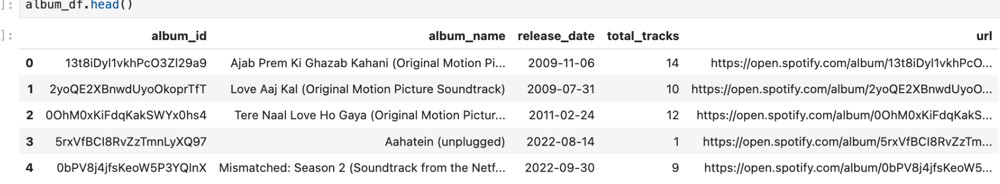
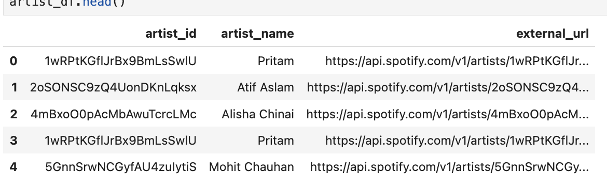

# 🎧 Spotify Data Engineering Pipeline

**Spotify Web API → Python → AWS → SQL Analytics**

An end-to-end data pipeline that extracts Spotify playlist data, transforms it into structured datasets, stores it in Amazon S3, and makes it queryable through Amazon Athena.

Built by **Gaurav Ambasta** to explore the complete journey from API ingestion to cloud-based analytics.

[GitHub Repository](https://github.com/GauravAmbasta2405/spotify-data-engineering-pipeline) · [LinkedIn](https://www.linkedin.com/in/gaurav-ambasta/) · [LeetCode](https://leetcode.com/u/gauravambasta24/)

---

## 🏗️ Architecture



## 🎯 Project Overview

The pipeline processes Spotify playlist data into three datasets:

- 🎵 **Songs:** Track identifiers, names, duration, URLs, and added timestamps.
- 💿 **Albums:** Album identifiers, names, release dates, track counts, and URLs.
- 🎤 **Artists:** Artist identifiers, names, and external Spotify URLs.

### Source playlist

[**Open the Spotify playlist**](https://open.spotify.com/playlist/0kg3Niymj7CG4ArhD6lN7W)



---

## ⚙️ Pipeline Workflow

### 1. Extract — Spotify API to S3

**File:** `spotify_api_data_extract.py`

- Authenticates with Spotify using `SpotifyOAuth`.
- Retrieves playlist items through Spotipy.
- Uploads the raw API response as JSON to Amazon S3.

```text
raw_data/to_processed/
```

The extraction Lambda can run on a schedule configured through Amazon EventBridge.

### 2. Transform — JSON to structured datasets

**File:** `spotify_transformation_load.py`

The transformation Lambda reads raw JSON files and uses Python and Pandas to extract the relevant fields into three DataFrames.

| Songs         | Albums         | Artists        |
| ------------- | -------------- | -------------- |
| `song_id`     | `album_id`     | `artist_id`    |
| `song_name`   | `album_name`   | `artist_name`  |
| `duration_ms` | `release_date` | `external_url` |
| `url`         | `total_tracks` |                |
| `song_added`  | `url`          |                |
| `album_id`    |                |                |
| `artist_id`   |                |                |

Album and artist records are deduplicated by their IDs within each transformation batch. The datasets are exported as timestamped CSV files.

### Transformed data previews

<details>
<summary><strong>🎵 Songs DataFrame</strong></summary>



</details>

<details>
<summary><strong>💿 Albums DataFrame</strong></summary>



</details>

<details>
<summary><strong>🎤 Artists DataFrame</strong></summary>



</details>

### 3. Store — Amazon S3

```text
raw_data/
├── to_processed/
└── processed/

transformed_data/
├── song_data/
├── album_data/
└── artist_data/
```

The raw JSON files are moved to `processed/` after transformation, and the resulting CSVs are stored in their respective folders.

### 4. Catalogue — AWS Glue

AWS Glue Crawlers discover the structure of the transformed datasets and register table metadata in the Glue Data Catalog.

The three datasets are organized under the `spotify_db` database. The Catalog stores the table definitions and S3 locations; the actual CSV data remains in S3.

### 5. Query — Amazon Athena

Athena uses SQL to query the transformed datasets in S3 through the table definitions in the Glue Data Catalog.

Example: rank albums by their total track count.

```sql
SELECT
    album_name,
    SUM(CAST(total_tracks AS BIGINT)) AS total_tracks
FROM spotify_db.spotify_albums
GROUP BY album_name
ORDER BY total_tracks DESC;
```

The cast converts `total_tracks` to a numeric type when the CSV-backed table exposes it as text.

---

## 🛠️ Tech Stack

| Technology                | Purpose                               |
| ------------------------- | ------------------------------------- |
| Python                    | Extraction and transformation         |
| Spotipy / Spotify Web API | Authentication and source data        |
| Pandas                    | Data transformation and deduplication |
| AWS Lambda                | Serverless processing                 |
| Amazon S3                 | Raw and transformed storage           |
| Amazon EventBridge        | Scheduled extraction                  |
| AWS Glue Crawlers         | Schema discovery                      |
| AWS Glue Data Catalog     | Table metadata                        |
| Amazon Athena             | SQL analytics                         |
| Jupyter Notebook          | Exploration and development           |

## 📁 Repository Structure

```text
spotify-data-engineering-pipeline/
├── README.md
├── Spotify Data Pipeline.ipynb
├── spotify_api_data_extract.py
├── spotify_transformation_load.py
├── .gitignore
└── assets/
    ├── spotify-playlist.png
    ├── songs-dataframe.png
    ├── albums-dataframe.png
    └── artists-dataframe.png
```

## 🚀 Setup

### Prerequisites

- Python 3
- Spotify Developer application
- AWS account with access to Lambda, S3, Glue, and Athena

### Install dependencies

```bash
python3 -m pip install spotipy boto3 pandas
```

### Configure Spotify credentials

Set the following environment variables in the extraction Lambda:

```text
client_id
client_secret
refresh_token
```

Never commit real credentials, refresh tokens, AWS access keys, `.ENV` files, or cached authentication files to GitHub.

### Configure AWS

1. Create an S3 bucket with the raw and transformed prefixes shown above.
2. Deploy `spotify_api_data_extract.py` as the extraction Lambda.
3. Deploy `spotify_transformation_load.py` as the transformation Lambda with Pandas available in its deployment package or layer.
4. Configure an EventBridge schedule for extraction.
5. Configure an S3 Object-Created notification for JSON files in `raw_data/to_processed/`.
6. Configure the Glue database and crawlers for the three transformed-data prefixes.
7. Configure Athena's S3 query-result location and create or discover the external table definitions.

Use your own bucket name and AWS region. Lambda execution roles need the appropriate S3 permissions for the operations they perform.

---

## 🔐 Security

- Spotify credentials are read from environment variables.
- AWS access is managed through Lambda execution roles.
- Do not publish secrets, cached tokens, or private data in the repository.
- Check notebook outputs and Git history before pushing changes.

---

<div align="center">

**Built by Gaurav Ambasta**

_From raw Spotify data to queryable cloud datasets._

[GitHub](https://github.com/GauravAmbasta2405) · [LinkedIn](https://www.linkedin.com/in/gaurav-ambasta/)

</div>
